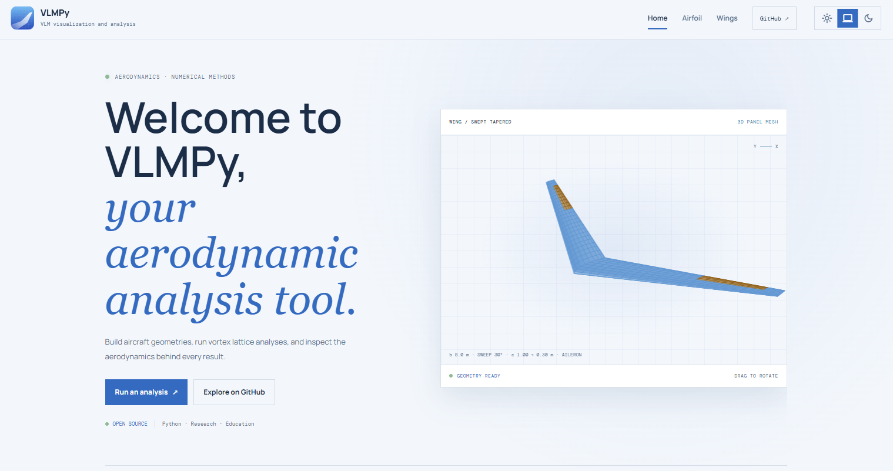
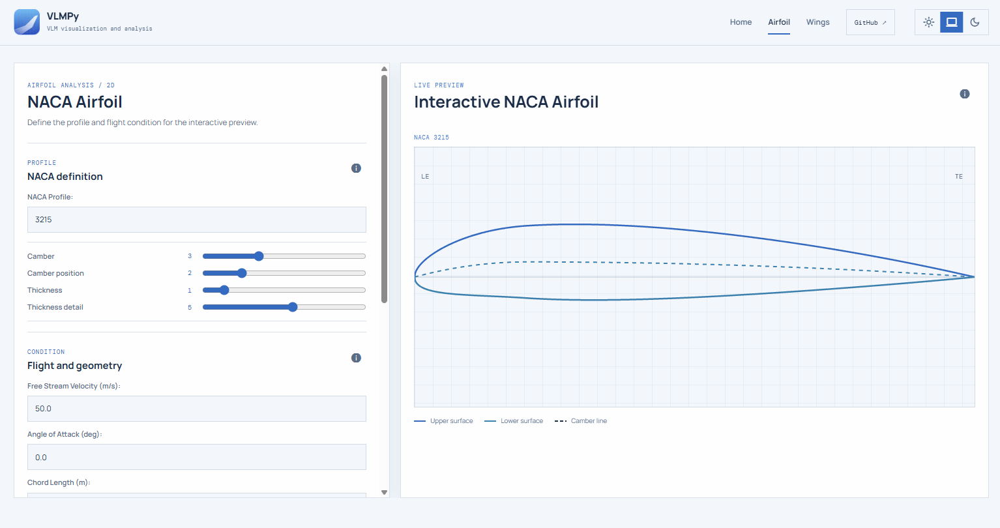
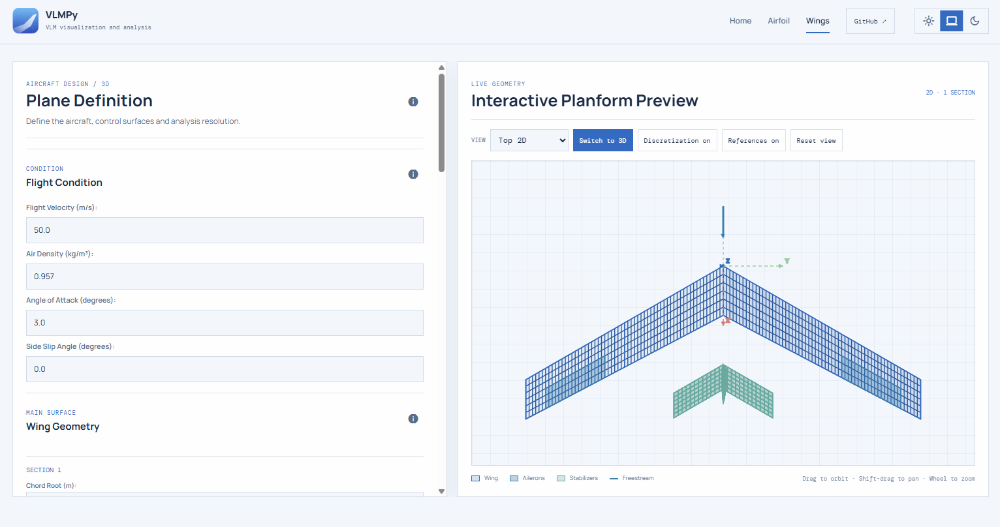
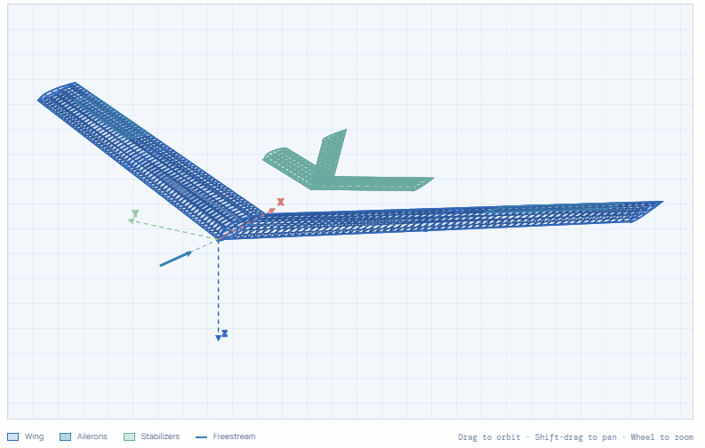
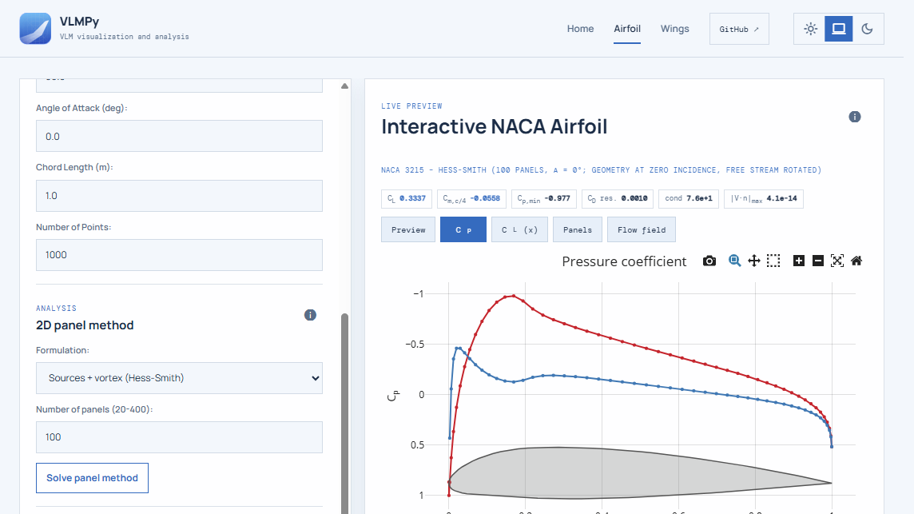
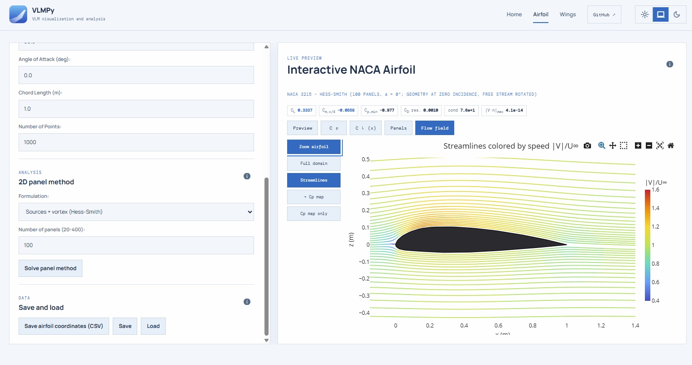
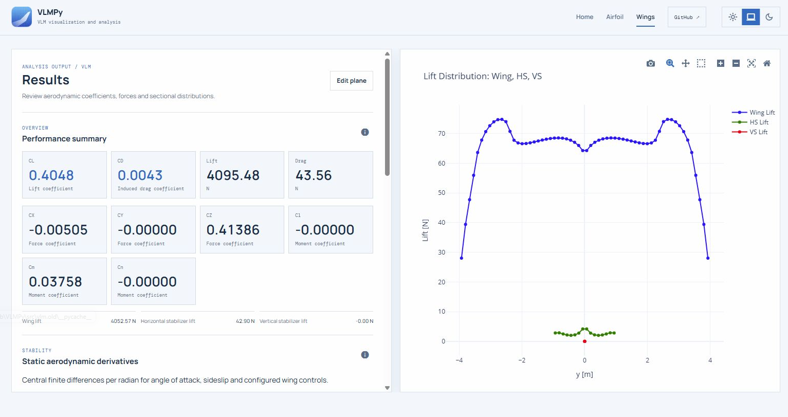
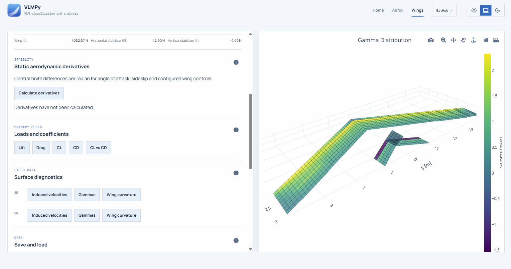
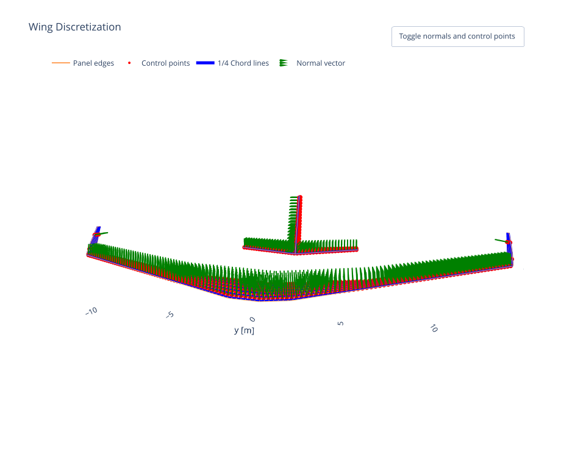

# VLMPy: Vortex Lattice Method App

<p align="center">
    
</p>

**VLMPy** is a modern, open-source Python toolkit and application for aerodynamic analysis of wings using the Vortex Lattice Method (VLM). Designed for engineers, students, and enthusiasts, VLMPy makes it easy to model, visualize, and analyze lift and drag for a wide range of wing configurations in subsonic, inviscid flow.

[](LICENSE)
[](https://github.com/JaviLendi/VLMPy/issues)
[](https://github.com/JaviLendi/VLMPy/stargazers)
[](https://github.com/JaviLendi/VLMPy/network/members)
[](https://github.com/JaviLendi/VLMPy/commits/main)
[](https://www.python.org/downloads/)
[](https://github.com/JaviLendi/VLMPy/releases)
[](https://github.com/JaviLendi/VLMPy)

---

## Table of Contents

- [Table of Contents](#table-of-contents)
- [Introduction](#introduction)
- [Features](#features)
  - [Screenshots](#screenshots)
- [Installation](#installation)
  - [Prerequisites](#prerequisites)
  - [Option 1: Windows Executable (Windows 10/11)](#option-1-windows-executable-windows-1011)
  - [Option 2: Install from Source](#option-2-install-from-source)
- [Usage](#usage)
- [Project Structure](#project-structure)
- [Submitting Issues](#submitting-issues)
- [License](#license)
- [Author](#author)
- [Acknowledgements](#acknowledgements)

---

## Introduction

**VLMPy** is an open-source Python tool for aerodynamic analysis of wings using the Vortex Lattice Method (VLM). It is designed for aerospace engineers, students, and aviation enthusiasts to model lift and drag in subsonic, inviscid flow conditions. This project began as a Final Year Project in Aerospace Engineering.

---

## Features

- **Accurate VLM Implementation**: Compute aerodynamic coefficients ($C_L$, $C_D$, moments) for wing configurations.
- **Interactive Visualization**: 2D/3D plots of lift distribution, pressure coefficients, and geometry using Plotly and Matplotlib.
- **Customizable Geometry**: Define wing parameters like sweep, dihedral, taper, and control surfaces.
- **External Geometry Roadmap**: Plan support for OpenVSP workflows and STL surface-mesh inspection and import, subject to explicit unit, coordinate, component-mapping, and aerodynamic-panelization validation.
- **Flexible Flight Conditions**: Analyze multiple angles of attack, sideslip angles, and airspeeds.
- **NACA Airfoil Support**: Generate and analyze NACA airfoil profiles.
- **Modular Architecture**: Extensible Python codebase for custom analyses and integration with NumPy, Matplotlib, and more.
- **User-Friendly Interface**: Intuitive Python API, ready-to-use executables, and Jupyter notebook examples.
- **Comprehensive Documentation**: Step-by-step guides and practical examples.
- **Performance Instrumentation**: Cached VLM stages, vectorized influence assembly, and optimized Plotly rendering. See [the performance validation guide](docs/README-performance.md).

---

### Screenshots

<div align="center">

<table align="center">
   <tr>
      <td></td>
   </tr>
   <tr>
      <td align="center">Home (desktop)</td>
   </tr>
   <tr>
      <td></td>
   </tr>
   <tr>
      <td align="center">NACA Airfoil Definition and Live Preview</td>
   </tr>
   <tr>
      <td></td>
   </tr>
   <tr>
      <td align="center">Wing Definition and 2D Planform Preview</td>
   </tr>
   <tr>
      <td></td>
   </tr>
   <tr>
      <td align="center">Wing Definition and 3D Planform Preview</td>
   </tr>

</table>

<details>
<summary>View all screenshots</summary>

- **2D Panel-Method Pressure Coefficient (NACA 3215)**  
   

- **2D Panel-Method results (NACA 3215)**  
   

- **Plane or Wing Results Panel Dashboard (CL Plot)**  
   

- **Plane or Wing Results Panel Dashboard (3D Plot)**  
   

- **3D Wing Discretization (A320)**  
   

- **Vorticity Distribution (Flat Plate with Aileron)**  
   

</details>
</div>

## Installation

### Prerequisites

- **Python 3.8+** (for source installation)
- **Web Browser** (Chrome 90+, Firefox 85+, or equivalent)
- **Git** (optional, for cloning the repository)

### Option 1: Windows Executable (Windows 10/11)

1. Download `app.exe` from the [Releases page](https://github.com/JaviLendi/VLMPy/releases).
2. Double-click to launch the application—no additional setup required.

### Option 2: Install from Source

1. Clone the repository:

   ```bash
   git clone https://github.com/JaviLendi/VLMPy.git
   cd VLMPy
   ```

2. Install the application dependencies:

   ```bash
   python -m pip install numpy Flask flask-compress plotly matplotlib numpy-stl psutil PySide6
   ```

   *Tip*: Update pip with `python -m pip install --upgrade pip` if needed.
3. Run the app:

   ```bash
   python src/vlm/app.py
   ```

4. Access the web interface at [http://localhost:5001](http://localhost:5001).

---

## Usage

- **Executable**: Launch `app.exe` (Windows) for a standalone experience.
- **Python API**: Core modules for custom analyses are in `src/vlm/lib/`.
- **Jupyter Notebooks**: Explore example notebooks in `docs/notebooks/` for guided tutorials.
- **Web Interface**: Run `python src/vlm/app.py` to access the interactive web app at [http://localhost:5001](http://localhost:5001).

Example notebooks and documentation are available in `docs/notebooks/` and `docs/`.

---

## Project Structure

```text
VLMPy/
├── src/
│   └── vlm/
│       ├── app.py         # Application entry point
│       ├── lib/           # Core VLM and utility modules
│       ├── static/        # Static assets
│       ├── templates/     # HTML templates for web interface
│       └── data/          # Application data and saved configurations
├── docs/
│   ├── notebooks/         # Example Jupyter notebooks
│   └── screenshots/       # Application and analysis screenshots
├── tests/                 # Automated tests
├── README.md             # Project documentation
└── LICENSE               # License information
```

---

## Submitting Issues

Found a bug or have a suggestion? Please open an issue on GitHub.

1. Search existing issues to avoid duplicates.
2. Provide a clear title and detailed description.
3. Include steps to reproduce, expected behavior, and relevant screenshots or logs if possible.

Your feedback helps improve VLMPy!

---

## License

VLMPy is distributed under the [GNU Affero General Public License v3.0 (AGPL-3.0)](LICENSE).

---

## Author

**Javier Lendínez Castillo**  
*Aerospace Engineer*

- 💼 GitHub: [@JaviLendi](https://github.com/JaviLendi)
- 🏫 Universidad Alfonso X el Sabio

---

## Acknowledgements

- **Supervisor**: Héctor Gómez Cedenilla
- **Institution**: Universidad Alfonso X el Sabio
- **Date**: June 2025

- **Additional Acknowledgements**: Marcos Antonio Rodríguez and Ignacio Maroto Villar, professors at Universidad Alfonso X el Sabio

> ℹ️ For academic details and mathematical derivations, see `docs/TFG.pdf` (coming soon) and source code appendices.

---
