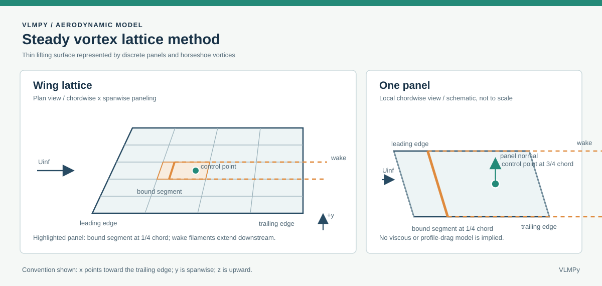

# VLMPy: Vortex Lattice Method

<div align="center">

<table>
    <tr>
        <td style="vertical-align: middle; width: 65px;">
            
        </td>
        <td style="vertical-align: top; padding-left: 20px;">
            <strong>Author:</strong> Javier Lendínez<br>
            <strong>Supervisor:</strong> Héctor Gómez Cedenilla<br>
            <strong>Date:</strong> June 2025<br>
            <strong>Application release:</strong> <a href="https://github.com/JaviLendi/VLMPy/releases/tag/v1.1.0">VLMPy 1.1.0</a>
        </td>
    </tr>
</table>

</div>

---

**Academic scope:** The TFG (Final Degree Project/thesis) covers VLMPy up to version 1.0.1. Version 1.0.2 and later releases are post-thesis development and are outside the academic project's scope.

## 📑 Table of Contents

- [📑 Table of Contents](#-table-of-contents)
- [🚀 Introduction](#-introduction)
- [✨ Key Features](#-key-features)
- [⚙️ Installation and Setup](#️-installation-and-setup)
  - [🛠️ Prerequisites](#️-prerequisites)
  - [📥 Step-by-Step Instructions](#-step-by-step-instructions)
- [🧑‍💻 Usage Examples](#-usage-examples)
  - [✈️ Example: Analyzing a Rectangular Wing](#️-example-analyzing-a-rectangular-wing)
- [⚠️ Limitations](#️-limitations)
- [📄 License](#-license)

---

## 🚀 Introduction

> **VLMPy** is an open-source tool for the aerodynamic analysis of wings using the Vortex Lattice Method (VLM).
> It is ideal for aerospace engineers, students, and aviation enthusiasts looking for an intuitive and powerful way to model lift and drag on wings.

The VLM is widely used in computational fluid dynamics (CFD) to predict the aerodynamic behavior of wings in subsonic, inviscid flow. VLMPy implements this method in Python, making it easier to analyze and visualize results.

<div align="center">



</div>

This project originated as part of an Aerospace Engineering undergraduate thesis, connecting aerodynamic theory with practical engineering applications.

---

## ✨ Key Features

- **Steady aerodynamic coefficients:**
    Calculates $C_L$, induced $C_D$, and the force and moment coefficients $C_X$, $C_Y$, $C_Z$, $C_l$, $C_m$, and $C_n$. Static derivatives with respect to alpha, beta, and configured control deflections are estimated using central differences.
- **Interactive Visualization:**
    2D and 3D Plotly graphs for geometry, pressure, and forces.
- **Customizable Wing Geometry:**
    Supports sweep, dihedral, taper, and control surfaces (flaps and ailerons).
- **Multiple Flight Conditions:**
    Analyze different angles of attack, sideslip angles, and airspeeds.
- **NACA Airfoil Support:**
    Generate and analyze standard NACA airfoils.
- **Modular Architecture:**
    Easily extend or modify the code for advanced research.

---

## ⚙️ Installation and Setup

### 🛠️ Prerequisites

- **Python 3.8+**
- **Git**
- **Web Browser:** Chrome 90+, Firefox 85+, or equivalent

### 📥 Step-by-Step Instructions

1. **Clone the repository:**
        ```bash
        git clone https://github.com/JaviLendi/VLMPy.git
        cd VLMPy
        ```

2. **Install the dependencies:**
        ```bash
        pip install -r requirements.txt
        ```
        > 💡 *If you encounter problems, upgrade pip with `pip install --upgrade pip`.*

3. **Run the application:**
        ```bash
        python src/vlm/launcher.py
        ```
        Or install VLMPy 1.1.0 on Windows 10/11 using the installer from the [v1.1.0 release](https://github.com/JaviLendi/VLMPy/releases/tag/v1.1.0).

4. **Open the interface:**
    The VLMPy desktop window opens automatically.

#### 💻 Using the Installer (Windows 10/11)

Download `VLMPy-Setup-1.1.0.exe` from the [v1.1.0 release](https://github.com/JaviLendi/VLMPy/releases/tag/v1.1.0) and run the installer.

---

## 🧑‍💻 Usage Examples

The following is a typical workflow for analyzing a rectangular wing:

### ✈️ Example: Analyzing a Rectangular Wing

1. **Define the Airfoil**
        - Open the NACA definition page.
        - Enter the NACA code (e.g., 0012).
        - Set the chord, angle of attack, and airspeed.
        - Select the option to create the plot.

2. **Configure the Wing**
        - Open the aircraft definition page.
        - Parameters:
            - Root chord: 1 m
            - Tip chord: 1 m
            - Wingspan: 10 m
            - Sweep/dihedral: 0°
        - Select the NACA airfoil.
        - (Optional) Add flaps or other control surfaces.

3. **Set the Flight Conditions**
        - Airspeed: 50 m/s
        - Density: 1.225 kg/m³
        - Angle of attack: 5°
        - Sideslip angle: 0°

4. **Set the Discretization**
        - Spanwise panels (n): 20
        - Chordwise panels (m): 10

5. **Run the Calculation**
        - Select the option to calculate.
        - View the geometry and discretization in 2D/3D.

6. **Analyze the Results**
        - Open the Results page to start the VLM analysis.
        - Review $C_L$, $C_D$, and pressure distributions.
        - Export the results to CSV or JSON.

For advanced examples (swept or tapered wings and control surfaces), see the user manual *(in development)*.

---

## ⚠️ Limitations

- **Flow assumptions:** Inviscid and incompressible flow (not suitable for transonic or supersonic conditions, or viscous effects).
- **Geometry:** Optimized for thin wings; does not model thick wings or fuselages.
- **Axes and references:** Body axes have $x$ forward, $y$ right, and $z$ down; moments follow the right-hand rule. They are normalized using wing planform area, span, and mean chord. The moment reference point is the area-weighted mean quarter-chord, not the center of gravity. The legacy $C_L/C_D$ retains its previous normalization by total panel area; with stabilizers, it should not be compared directly with $C_Z/C_X$.
- **Derivatives:** Static and expressed per radian; they do not include dynamic derivatives with respect to angular rates and do not constitute a complete stability analysis.
- **Drag:** $C_D$ is induced drag in the current model. Profile or parasite drag, separation, and stall are not calculated.
- **Resources:** A large number of panels increases computation time.
- **Operating System:** The executable has only been tested on Windows 11 (it should work on Windows 10).

---

## 📄 License

VLMPy is distributed under the **GNU Affero General Public License v3.0 (AGPL-3.0)**.
See the `LICENSE` file for details.

---

> ℹ️ **Note:** For academic details and mathematical derivations, see `docs/TFG.pdf` (coming soon) and the source code appendices.
